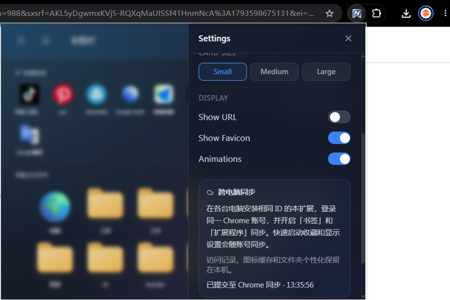
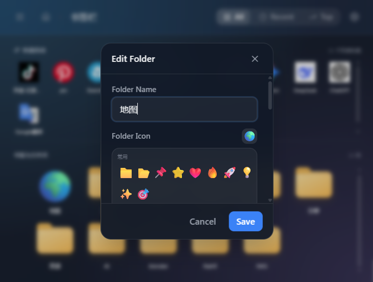

<p align="center"></p>

# Nahfi Bookmark Manager

一个适用于 Chrome 的书签管理扩展：固定快速启动、无框 Liquid Glass 界面、高清图标本地缓存和 Chrome 账号同步。

**当前版本：1.1.0** · [更新记录](CHANGELOG.md) · [版本标签](https://github.com/zhangweig/nahfi-bookmark-manager/tree/v1.1.0) · [MIT 许可证](LICENSE)

## 界面截图

### 显示设置与跨电脑同步

支持卡片大小、URL 显示、网站图标和动画开关，并在设置面板展示 Chrome 同步说明与提交状态。



### 文件夹编辑与自定义图标

编辑文件夹名称，选择 Emoji 图标，保存后用于书签文件夹网格。



## 下载与安装

**[下载最新扩展 ZIP](https://raw.githubusercontent.com/zhangweig/nahfi-bookmark-manager/main/nahfi-bookmark-manager.zip)** · [GitHub Releases](https://github.com/zhangweig/nahfi-bookmark-manager/releases)

1. 下载并解压 ZIP。
2. 打开 `chrome://extensions`，开启右上角“开发者模式”。
3. 点击“加载已解压的扩展程序”，选择包含 `manifest.json` 的解压文件夹。
4. 在 Chrome 扩展菜单中固定 Nahfi，即可从工具栏打开。

**升级时覆盖原文件夹，再点击扩展的“重新加载”。不要先卸载或更换加载路径，以免丢失本地缓存与设置。** Chrome 的快捷键可以在 `chrome://extensions/shortcuts` 中调整。

## 功能

- **固定快速启动**：常用网站保留在顶部；右键书签选择“添加到快速启动”或“从快速启动移除”。同一网址只显示一个入口。
- **书签与文件夹**：下方网格独立滚动，支持文件夹树、面包屑导航，以及 All、Recent、Top 视图。
- **轻量视觉**：方角窗口、无图标底框、深浅色／系统主题、可调整卡片大小、URL 与动画开关。
- **书签管理**：创建、编辑、删除、移动书签或文件夹，支持外部链接拖入及文件夹拖放。
- **个性化**：文件夹 Emoji、快捷收藏、访问计数和最近访问；列表使用虚拟滚动。
- **新版插件图标**：独立玻璃 N 书签主体，裁去外框与留白，适配 16、32、48、128px。

## 高清图标与本地缓存

后台会读取网站声明的图标与 PWA manifest，并检查常见高清图标路径。可用的位图按实际尺寸比较，优先使用网站矢量图标；Google／DuckDuckGo 等服务作为回退。聚合服务返回较大的图片不等于原图包含更多细节。

安装或升级后，会以两个网站并行的方式初始化／升级缺失或旧版缓存。打开弹窗时先显示已有图标，后台结果完成后更新。成功的结果保存在 `chrome.storage.local`，不再按七天过期，重启电脑或浏览器后直接复用。首次加载需要时间，失败的网站可稍后重试，或右键选择 **Refresh icon**。

如果网站只提供低分辨率素材，插件无法恢复其缺失细节。图标文件本身带有的底色会保留；界面不会额外添加外框。删除扩展或清除其存储会删除本地缓存。

## 跨电脑同步

快速启动收藏与显示设置使用 `chrome.storage.sync`；收藏按**完整网址**匹配，不依赖不同电脑上的本地书签 ID。取消收藏会保留移除状态，避免被旧数据重新添加；失败的写入会在本地排队，下次打开时重试，也可在设置面板手动重试。

要求：

- 各台电脑登录同一 Chrome 账号，并开启书签与扩展同步。
- 各台电脑使用**相同的扩展 ID**。分别加载的解压版可能因路径不同产生不同 ID，无法共享扩展同步数据。
- 书签目录本身由 Chrome 的书签同步管理；插件不自建账号或同步服务器。

访问记录、最近访问、文件夹个性化和图标缓存保留在本机。设置中的成功提示表示已提交给 Chrome 同步存储，不代表另一台电脑已收到。Chrome 同步配额仍然适用；真实双机账号同步尚未在当前云环境实测。

## 隐私与权限

- `bookmarks`：读取、创建、编辑、移动和删除用户书签；这些管理操作会改变真实书签。
- `storage`：保存本地数据与 Chrome 同步数据；`unlimitedStorage` 用于本地图标缓存。
- `favicon`：读取 Chrome 内置 favicon 缓存。
- `<all_urls>`：访问书签网站的页面、图标及 PWA manifest，以发现高清图标。请求使用 `credentials: 'omit'`，不携带站点登录凭据。
- 图标查询可能访问书签网站、Google 或 DuckDuckGo；第三方可接收到被查询的网址或域名。快捷收藏的网址与显示设置通过 Chrome 账号同步。
- 不自建后端，不含分析或广告追踪。其他本地元数据不会由插件主动上传至应用服务器。

## 开发与构建

使用 Node.js 18+ 和 npm；本版本在 Node.js 24 / npm 11 上验证。由于现有锁文件的可选 peer 依赖布局，安装时需要 `--legacy-peer-deps`。

```bash
git clone https://github.com/zhangweig/nahfi-bookmark-manager.git
cd nahfi-bookmark-manager
npm ci --legacy-peer-deps
npm run dev
```

开发页面位于 `/src/popup/index.html`。完整功能依赖 Chrome 扩展 API，普通网页不能直接操作书签。实际调试时构建后加载 `dist/`，修改后重新构建并重新加载扩展。

```bash
npm test           # 10 项逻辑测试
npm run lint       # ESLint
npm run build      # TypeScript + Vite，输出 dist/
npm run package    # 构建并生成根目录 nahfi-bookmark-manager.zip，需要 Python 3
```

ZIP 包只包含运行所需文件与安装说明，不携带编辑用的高清图标源文件。发布前提交最新生成的 ZIP，使 README 的直接下载入口与源码版本一致。

`npm run icons` 从 `public/icons/icon-source.png` 重新生成 16/32/48/128px 图标，需要 ImageMagick（`magick` 或 `convert`）。`npm run format` 会格式化源码。

## 验证范围

现有测试覆盖：跨设备书签 ID 映射、收藏移除与迁移、同步失败重试、远端读取失败保护、设置校验、图标回退、安全网址处理、高清图标比较、并发缓存写入及模拟后台重启后的离线缓存复用。

浏览器界面检查使用隔离的 Chrome API 测试数据，验证快捷收藏操作、文件夹导航、主题切换、无外框布局及低分辨率图标回退。实际网站的可访问性、Chrome 原生扩展加载与真实双机同步仍需要在目标浏览器验证。

## 项目结构

```text
src/
  background/        书签事件、后台图标初始化与消息处理
  components/        快速启动、图标、文件夹、设置与同步状态面板
  hooks/             主题与虚拟滚动
  store/             Zustand 应用状态
  utils/bookmarks.ts Chrome 书签 API 封装
  utils/storage.ts   本地元数据和缓存
  utils/sync.ts      账号同步、网址映射与失败重试
  utils/icon-cache.ts 高清图标发现、比较和持久缓存
  utils/favicon.ts   即时图标回退和字母占位
  popup/             弹窗入口
scripts/             图标生成与 ZIP 打包
tests/               同步和图标测试
```

## 发布与贡献

版本号同时维护在 `package.json`、锁文件与 `public/manifest.json`；设置面板读取扩展版本。推送 `v*.*.*` 标签后，GitHub Actions 会安装依赖、运行测试、构建、打包并发布 Release 附件，要求仓库启用 Actions。发布说明见 [RELEASE_NOTES.md](RELEASE_NOTES.md)。

欢迎提交 Issue 或 Pull Request。作者：[Zhang WeiGuang](https://github.com/zhangweig)。许可证：[MIT](LICENSE)。
